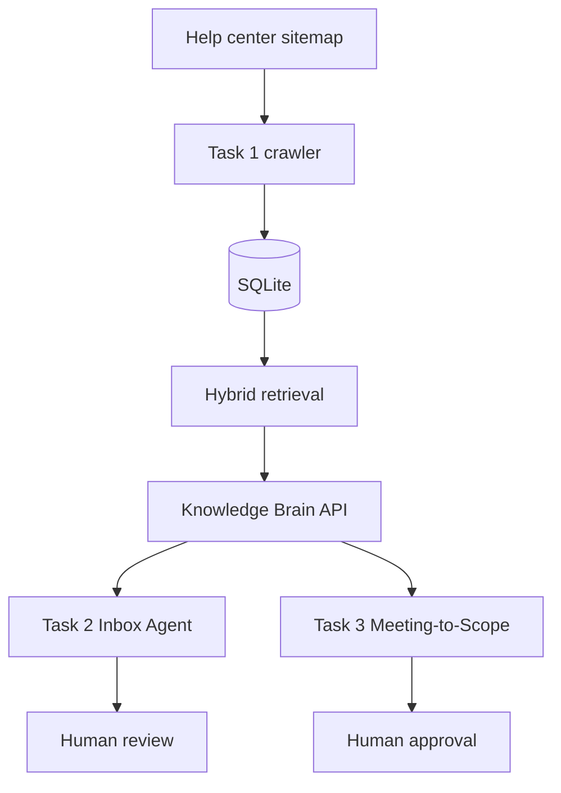

# Design

## Architecture

Task 1 is the shared knowledge service. It ingests help-center articles, stores content in SQLite, retrieves relevant evidence, and exposes a FastAPI HTTP API.

Task 2 sends an email question to Task 1 and creates a draft with source information. The current prototype processes a hard-coded sample email and does not send messages.

Task 3 extracts candidate requirements from a meeting transcript, calls Task 1 for a knowledge-based feasibility check, creates provisional estimates, and compares requirement text with a supplied baseline. Its current baseline comparison is a simple text comparison.

## Technology choices

- FastAPI and Python for the knowledge service.
- SQLite for local persistence.
- HTTP requests between the task applications.
- TypeScript and Node.js for the Inbox Agent.
- Python and Pydantic for Meeting-to-Scope.
- A local sentence-transformer embedding model and lexical relevance signals for retrieval.
- Anthropic is configured as the answer provider when credentials are available; the service also has an evidence-based fallback.

## Safety and limitations

- Email output is draft-only. No email is sent by the current prototype.
- Scope estimates and requirement changes need human approval.
- A relevant search result does not by itself prove a feature is technically feasible.
- Requirement extraction can include discussion or consultant notes that need human classification.
- Baseline comparison uses simple text matching and can miss semantic changes.
- Screenshot understanding, scheduled ingestion, deleted-page reconciliation, a production escalation queue, full multi-agent orchestration, and production-grade model comparisons are not verified as complete.
- Performance, accuracy, and cost must be measured with fixed evaluation datasets before making claims about quality.
